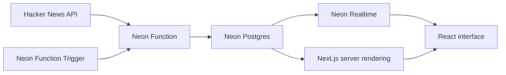

# Hacker Realtime

A familiar Hacker News interface where stories, scores, rankings and comment
threads update live. New stories expand into the list, stories animate as their
rank changes, and updated scores and comment counts light up individually. A
moving timeline lets you inspect changes across the demo, including items
outside your current view.

The demo is built with **Neon Realtime**, which lets applications subscribe to
live Postgres query results. When the underlying data changes, Neon Realtime
sends updates to the browser so the interface stays in sync automatically.

**[Try the live demo](https://hackernews-realtime.vercel.app/)** ·
**[Explore Neon](https://neon.com)** ·
**[Neon Realtime docs](https://neon.com/docs/realtime/overview)**

Browse the top and new feeds, or open a story's comment count to follow its
nested discussion live. Voting, replying, submitting and viewing profiles link
to the original Hacker News site.

## Built with Neon

| Service | How this demo uses it |
| --- | --- |
| **Neon Realtime** | Streams live query results for story lists, story metadata, comment threads and the event timeline to the browser. |
| **Neon Postgres** | Stores the Hacker News mirror, feed rankings, comments, event history and pending ingestion updates. |
| **Neon Functions** | Runs the ingester, maintaining connections to the Hacker News API and writing changes into Postgres. |
| **Neon Function Triggers** | Invokes ingestion every minute. Overlapping workers use database leases to hand off ingestion while keeping one active writer. |

Next.js and React provide the interface, Drizzle defines the database queries,
and Vercel hosts the web app. The source data comes from the
[official Hacker News API](https://github.com/HackerNews/API).

## How it works



### Ingesting Hacker News

The ingester subscribes to Hacker News's Firebase feeds and item updates, with
periodic REST reconciliation to refresh the mirror. It tracks the first 150
items in each of the top and new feeds. Comment threads are watched while
people have them open, with multiple viewers sharing the same upstream
subscription.

Feed membership and complete story records are written together. A Postgres
lease and fencing token ensure that only the active ingestion worker can
publish, while a standby worker prepares to take over. Pending changes are
stored in Postgres so they survive worker handoffs.

Hacker News can deliver changes in bursts. The ingester spreads updates over a
configurable window, defaulting to 28 seconds, to give the demo a steadier flow
of activity. This adds up to 28 seconds of delay after receiving a change.
Initial loads happen immediately, and feed reorders and comment-tree changes
stay atomic. Set `INGEST_SMOOTHING_MS=0` to publish updates immediately.

The ingestion implementation is in [ingest/](ingest/). The Neon Function and its
schedule are defined in [neon.ts](neon.ts), with the Function entry point in
[functions/ingest.ts](functions/ingest.ts).

### From SQL queries to a live interface

Next.js renders the initial stories and comments on the server. The server
also seals each query, producing a capability that lets the browser subscribe
to that specific query through Neon Realtime. Database credentials and the
Realtime sealing secret stay on the server.

The queries in [lib/queries.ts](lib/queries.ts) use Drizzle and Neon's Drizzle
adapter. One Realtime client in the root layout shares a connection across the
feed, discussion and timeline subscriptions. Internal navigation prepares the
destination's live queries before switching pages, and the connection stays
open as you move around.

Feeds show 30 stories per page. Discussions load a small initial batch of
comments, then fill in the remaining replies progressively, up to 500 comments
per story. Replies can be collapsed, and each thread links to the full original
discussion on Hacker News.

### Animations and the event timeline

React compares incoming rows by stable item ID to distinguish changed numbers,
arrivals, removals and rank changes. Number changes highlight only the affected
value; arriving rows expand and reordered rows animate to their new positions.

Postgres triggers record story, feed and comment changes in an event journal,
inside the same transaction as each change. A separate Realtime query powers
the footer timeline across all mirrored feeds and watched discussions.

The timeline shows two minutes on desktop and 60 seconds on mobile. Orange
markers relate to items on screen; grey markers relate to items elsewhere.
Items entering or leaving the viewport stay orange during their transition.
Hover, focus or tap a marker to inspect its details. The interface also respects
reduced-motion preferences.

## Run locally

### Prerequisites

- Node.js **22.23.2**, npm **10.9.8** and Git.
- Access to the Neon source repository used by `npm run bootstrap`, pinned in
  [neon-toolchain.lock.json](neon-toolchain.lock.json).
- A Neon Postgres branch with logical replication and Realtime enabled. Allow
  `http://localhost:3000` as a browser origin in its Realtime configuration.
  See the [Neon Realtime docs](https://neon.com/docs/realtime/overview) for setup.

### 1. Install

```sh
git clone https://github.com/samwillis/hackernews-realtime.git
cd hackernews-realtime
npm run bootstrap
npm ci
cp -n .env.example .env.local
```

Bootstrap builds the pinned Neon SDK and CLI with pnpm 10.30.3 and creates the
local packages required by `npm ci`.

### 2. Configure your branch

Fill in these values in `.env.local` using your branch's connection details:

| Variable | Value |
| --- | --- |
| `DATABASE_URL` | Pooled Postgres connection URL for application and ingestion queries. |
| `DATABASE_URL_UNPOOLED` | Direct Postgres connection URL for schema setup. |
| `NEON_REALTIME_SECRET` | Server-side secret used to seal live queries. |
| `NEON_REALTIME_URL` | Your branch's Realtime WebSocket endpoint, starting with `wss://`. |
| `NEXT_PUBLIC_NEON_REALTIME_URL` | The same WebSocket endpoint, exposed to the browser. |

Keep `.env.local` out of version control. Only the WebSocket endpoint belongs in
a browser-visible environment variable.

### 3. Create the schema and load the feeds

For a new branch, run:

```sh
npm run db:setup
npm run seed
```

This applies the migrations in [migrations/](migrations/) and loads real Hacker
News stories. If your branch already has an active ingester, skip seeding and
reuse that ingester.

### 4. Start the app and ingestion

Start Next.js:

```sh
npm run dev
```

In a separate terminal, start local ingestion:

```sh
npm run ingest -- --watch
```

Open **[localhost:3000](http://localhost:3000)**. The ingestion command repeats
sessions while the web app serves pages and subscribes to database changes. If
your branch already has a scheduled ingester, you only need the web app.

To disable smoothing locally, set `INGEST_SMOOTHING_MS=0` in `.env.local` and
restart the ingestion process. The default is `28000`; accepted values range
from `0` to `60000` milliseconds.
