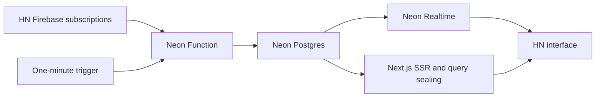

# Hacker Realtime

Hacker News with live stories, scores, comment counts and source ranking, powered
by Neon Realtime. Top and new feeds mirror the first 150 source items and show
30 rows per page. Pause freezes story data while the subscription stays open;
resume applies the latest ordered snapshot. Story comment links open live nested
threads in the demo. Replies, submissions, voting and profiles link to the real
Hacker News site. The orange header contains a square RT mark, top/new/submit
navigation and right-aligned live controls. Changed scores and counts pulse
individually; inserted rows expand and reordered rows animate.

Demo: [hackernews-realtime.vercel.app](https://hackernews-realtime.vercel.app/).
The demo uses Neon staging; [validation](docs/validation.md) records the current
evidence and remaining launch checks.

## Run locally

Use Node **22.23.2**, npm **10.9.8**, and Git. The bootstrap uses pinned
pnpm 10.30.3 to build Neon's unpublished SDK and CLI inside `.local/`.

```sh
npm run bootstrap
npm ci
cp -n .env.example .env.local
# Fill DATABASE_URL, DATABASE_URL_UNPOOLED, NEON_REALTIME_SECRET,
# NEXT_PUBLIC_NEON_REALTIME_URL from your Neon Realtime branch.
npm run db:setup
npm run seed
npm run dev
```

Open [localhost:3000](http://localhost:3000). The current workspace already has
configured staging credentials in its ignored `.env.local`; keep that file.
The shared staging ingester runs independently of the local web server.
For UI work without a database, use `HN_FIXTURE=1 npm run dev`. Fixture mode is
explicit and disabled in production. Open `/dev/updates` in fixture mode for
button-driven story/comment updates, arrivals, moves and pause/resume checks.

## Ingestion



One active writer and one prepared standby share a Postgres lease with a fencing
token. Each transaction checks ownership and expiry under a row lock. Feed
membership is published atomically with complete item records, and unchanged
rows are not rewritten. Firebase multiplexes the bounded item listeners;
authoritative REST reconciliation runs every minute and after reconnects.
Source health is independent of the browser's Realtime connection.
If a scheduled successor arrives late, the active worker keeps publishing while
waiting, bounded by its original request deadline.

The staged configuration uses a **two-minute active tenure**, a **90-second
preparation window**, and a **four-minute absolute invocation budget**. The
budget includes standby time and is never reset on promotion. Scheduled
requests completed successfully after roughly three minutes. This establishes
a working configuration without assuming the scheduler accepts the runtime's
full fifteen-minute limit. See [validation](docs/validation.md) for evidence and
remaining launch checks.

Set `INGEST_PROJECT_ID` and `INGEST_BRANCH_ID` to the dedicated shared branch,
then set `ENABLE_INGEST=1` and run:

```sh
npm run ingest:deploy
```

The `neon.ts` policy always creates a disabled schedule. The deployment wrapper
enables it only on the explicit target. Preview checkouts remain disabled.
Public requests cannot start the deployed ingester: it accepts only verified
native schedule deliveries. `npm run ingest` is a manual local invocation for
development and respects the same lease. It skips if a worker owns the branch.

To stop scheduled ingestion, set `ENABLE_INGEST=0` and run `npm run ingest:deploy`.
Existing requests finish by their recorded deadlines; browser rows then remain
visible with a stale-source indicator. Do not seed a branch already owned by
an active ingester.

## Live discussions

Click a story's comment count to open `/item?id=…`. Story metadata and nested
comments use separate fixed sealed queries over the same Realtime client.
The page renews its watch every ten seconds; the shared ingester discovers
watches every five seconds and uses its existing Firebase connection. Both
roles warm the watched trees before handoff. Comments publish in the same
fenced transaction as feed data. Text is rendered from a small HTML allowlist.
Deleted/dead comments remain placeholders, and branches can be collapsed.

The staging demo bounds ingestion to **three distinct watched stories** and
**up to 500 comments per story**. Watches expire 90 seconds after the last
renewal. A fourth discussion shows cached data with an HN-updates-busy indicator
and retries automatically. Large discussions link to the full original thread.
Prefetching a story link does not register a watch. These limits are explicit in
`lib/comments.ts`; raise them only with ingestion/load measurements.

## Checks

```sh
npm run typecheck
npm test
npm run test:db       # isolated schema; requires staging database credentials
npm run test:handoff  # delayed standby with real HN in an isolated schema
npm run test:recovery # real HN source; kills local workers in an isolated schema
npm run test:clean    # empty SDK/source/dependencies; bootstrap, npm ci, build
```

Database/recovery probes create and remove only their uniquely named test
schemas. `NEXT_PUBLIC_MEASURE_REALTIME=1` enables public-data timing diagnostics
in the browser console. Keep it at `0` for routine use.

## Deploy the web app

Use the pinned prebuilt Vercel workflow in
[docs/prerelease-build.md](docs/prerelease-build.md). Configure server secrets
with `node scripts/vercel-env.mjs production`; only the WebSocket endpoint is
public. Add the exact deployed origin to `DEMO_ORIGIN`, then apply the Neon
policy with `npm run ingest:deploy`.

The toolchain pins Neon's source commit, package hashes and Vercel CLI version.
Builds need no external Neon checkout. `.sdk/`, `.local/`, `.vercel/` and all
credentials are ignored. Git-driven hosting installs need this same bootstrap
before dependency installation.

## References

- [HN API](https://github.com/HackerNews/API)
- [Realtime preview documentation](https://neon-next-git-thruflo-realtime-3-integration-neondatabase.vercel.app/docs/realtime/)
- [Staging setup](docs/neon-staging.md)
- [Design and acceptance targets](PLAN.md)
