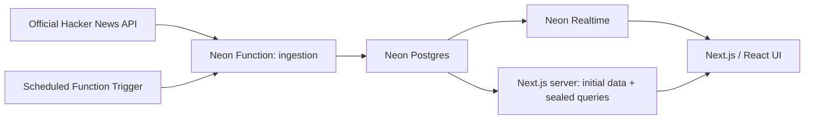

# Realtime Hacker News

A familiar Hacker News interface that updates as real stories gain points,
receive comments, enter a feed, or change rank. A launch demo for Neon Realtime.

## Status

Repository initialized. The implementation plan is a draft in [PLAN.md](PLAN.md).
The application and ingestion function will be added in the implementation phases.

## Proposed architecture

One shared ingester mirrors a bounded set of stories and feed positions into
Postgres. The browser subscribes to live SQL results through Neon Realtime.
The Next.js server supplies initial rows and short-lived sealed queries.

Initial scope: the top and new feeds, 30 stories per page, with live scores,
comment counts, and ranking changes. Voting and commenting link to Hacker News.

## Proposed stack

- Next.js, React, TypeScript, and Drizzle, adapting the Neon Realtime Next.js example.
- Neon Postgres with Realtime enabled on staging.
- Neon Functions with a scheduled Function Trigger for ingestion.
- The official public Hacker News Firebase API for source data.
- Locally built Neon SDK and CLI packages while the required releases are unpublished.

## Configuration

[.env.example](.env.example) lists the planned application variables. Real values
belong in a gitignored `.env.local`. The database URLs and Realtime sealing
secret stay on the server; only the Realtime WebSocket URL is public.

[docs/neon-staging.md](docs/neon-staging.md) records the staging setup requirements.
Exact install and run commands will be added once the app is scaffolded.

## References

- [Hacker News API](https://github.com/HackerNews/API)
- [Firebase REST streaming](https://firebase.google.com/docs/reference/rest/database#section-streaming)
- [Neon Realtime preview docs](https://neon-next-git-thruflo-realtime-3-integration-neondatabase.vercel.app/docs/realtime/)
- [Neon Functions runtime limits](https://neon.com/docs/compute/functions/reference/runtime-limits)
- [Scheduled Function Triggers](https://neon.com/docs/compute/functions/triggers/schedule)
