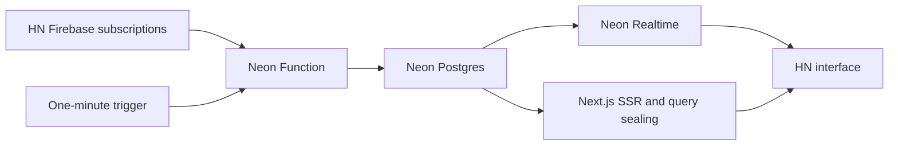

# Hacker Realtime

Hacker News with live stories, scores, comment counts and source ranking, powered
by Neon Realtime. Top and new feeds mirror the first 150 source items and show
30 rows per page. Live updates and change highlights are always enabled.
Story comment links open live nested
threads in the demo. Replies, submissions, voting and profiles link to the real
Hacker News site. The orange header contains a square RT mark, top/new/submit
navigation, a plain “Built with Neon Realtime” link, and compact connection
status. Changed scores and counts pulse
individually; inserted rows expand and reordered rows animate. A fixed bottom
timeline shows all mirrored events from the last 60 seconds on mobile or two
minutes on desktop, including changes
to stories and comments outside the current view.

Demo: [hackernews-realtime.vercel.app](https://hackernews-realtime.vercel.app/).
The demo uses Neon staging; [validation](docs/validation.md) records the current
evidence and remaining launch checks.

## Run locally

Use Node **22.23.2**, npm **10.9.8**, and Git. The bootstrap uses pinned
pnpm 10.30.3 to build Neon's unpublished SDK and CLI inside `.local/`.

```sh
npm run bootstrap
npm ci
cp -n .env.example .env.local
# Fill DATABASE_URL, DATABASE_URL_UNPOOLED, NEON_REALTIME_SECRET,
# NEXT_PUBLIC_NEON_REALTIME_URL from your Neon Realtime branch.
npm run db:setup
npm run seed
npm run dev
```

Open [localhost:3000](http://localhost:3000). The current workspace already has
configured staging credentials in its ignored `.env.local`; keep that file.
The shared staging ingester runs independently of the local web server.
For UI work without a database, use `HN_FIXTURE=1 npm run dev`. Fixture mode is
explicit and disabled in production. Open `/dev/updates` in fixture mode for
button-driven story/comment updates, arrivals and moves.

## Ingestion



One active writer and one prepared standby share a Postgres lease with a fencing
token. Each transaction checks ownership and expiry under a row lock. Feed
membership is published atomically with complete item records, and unchanged
rows are not rewritten. Firebase multiplexes the bounded item listeners;
authoritative REST reconciliation runs every minute and after reconnects.
Source health is independent of the browser's Realtime connection.
If a scheduled successor arrives late, the active worker keeps publishing while
waiting, bounded by its original request deadline.

HN's public Firebase export releases changes in roughly 32-second bursts. The
ingester now spreads story updates and individual comment edits across a
configurable window, defaulting to **28 seconds**. Set
`INGEST_SMOOTHING_MS=0` in `.env.local` and run `npm run ingest:deploy` to restore
immediate publication; local `npm run ingest` reads the same setting. Values
from 0 to 60000 are accepted. Running workers adopt deployment changes at the
next scheduled handoff.

This deliberately adds up to the configured delay after receiving an HN change.
Independent operations in each received batch receive evenly spaced deadlines.
Feed reorders and comment-tree structure changes remain atomic, so a large rank
shift can still share one timeline marker. New branches and initial discussion
loads fill immediately. Pending updates are stored in Postgres and survive
handoffs/restarts. Overlapping changes to the same row use the newest value at
the original deadline; a change that reverts before publication is cancelled.
Turning smoothing off drains outstanding work immediately when the new worker
becomes active. Timeline timestamps continue to describe actual mirror writes.

The staged configuration uses a **two-minute active tenure**, a **90-second
preparation window**, and a **four-minute absolute invocation budget**. The
budget includes standby time and is never reset on promotion. Scheduled
requests completed successfully after roughly three minutes. This establishes
a working configuration without assuming the scheduler accepts the runtime's
full fifteen-minute limit. See [validation](docs/validation.md) for evidence and
remaining launch checks.

Set `INGEST_PROJECT_ID` and `INGEST_BRANCH_ID` to the dedicated shared branch,
then set `ENABLE_INGEST=1` and run:

```sh
npm run ingest:deploy
```

The `neon.ts` policy always creates a disabled schedule. The deployment wrapper
enables it only on the explicit target. Preview checkouts remain disabled.
Public requests cannot start the deployed ingester: it accepts only verified
native schedule deliveries. `npm run ingest` is a manual local invocation for
development and respects the same lease. It skips if a worker owns the branch.

To stop scheduled ingestion, set `ENABLE_INGEST=0` and run `npm run ingest:deploy`.
Existing requests finish by their recorded deadlines; browser rows then remain
visible with a stale-source indicator. Do not seed a branch already owned by
an active ingester.

## Live discussions

Click a story's comment count to open `/item?id=…`. Story metadata and nested
comments use separate fixed sealed queries over the same Realtime client.
Uncached pages fetch the story and up to 20 top-level comments directly from HN
in the server page loader and navigation preparation endpoint. A short database
claim shares concurrent cold loads; seeds are committed before sealing live
queries, so SSR and the first live reset agree. No database connection is held
while contacting HN, and a newer worker publication takes precedence.

Each mounted page renews its own viewer watch every ten seconds and releases it
on navigation or closing. The ingester discovers watches every second on its
shared Firebase connection. Multiple viewers share one thread subscription;
there is no three-thread gate. Abandoned watches expire after 30 seconds.
Prefetching seeds the cache but does not register an ongoing ingestion watch.

Remaining comments appear progressively. Incomplete snapshots only insert
missing comments, preserving cached descendants and newer values; reconciled
snapshots update and remove rows authoritatively. Worker writes remain in the
same fenced transaction as feed data. Handoff readiness follows the feed, so a
newly opened discussion cannot block the entire ingester's transfer. Text uses
a small HTML allowlist, deleted/dead parents remain placeholders, and branches
can be collapsed. The demo displays **up to 500 comments per story**, with a
link to the full original discussion for larger threads. Broader concurrent
viewer load testing remains outstanding.

## Event timeline

The footer shows the last 60 seconds on screens up to 750px wide and two minutes
on larger screens: new events appear at the right and drift
left. Orange marks relate to items inside the unobscured viewport; grey marks
relate to items elsewhere. Scrolling and collapsing replies update these colours.
The before/after viewport union stays orange during the 320ms row transition,
including arrivals, removals and rows that cross the screen while reordering.

Hover, focus or tap a marker to inspect it. Events in the same second share a
counted marker; its scrollable details include every event, with no type filter
or burst cap. Inspection holds the timeline steady; Escape, the close button or
an outside tap dismisses the details. Header pause freezes both the page and the
timeline. Reduced motion advances the timeline in one-second steps.

Postgres triggers journal story, feed and comment writes inside the same fenced
transaction. A separate sealed Realtime query streams all journal rows, independent
of the current feed, page or discussion. Unchanged fields and timestamp-only
writes emit no event. The journal retains 15 minutes and is pruned during ingestion;
the UI displays the most recent 60 seconds on mobile or two minutes on desktop.
“All events” means all changes mirrored
by this demo's bounded feeds and watched discussions. Comment body details are
short text excerpts. Run `npm run db:setup` to apply all migrations before
deploying an updated ingester.

## Navigation and server rendering

Next App Router renders initial feed rows, story metadata and comments on the
server. The async page components query Postgres and seal their fixed live
queries; the resulting HTML already contains the content before JavaScript runs.
Client navigation fetches a server component payload for the destination.

One Realtime client in the root layout multiplexes all page and timeline queries.
The connection indicator follows its actual transport lifecycle, with query
failures and reconnects still reported. Pause, highlighting, source health and
the event timeline persist when changing pages.

Internal links prefetch the Next route and prepare its live subscriptions on
hover/focus or click. Navigation waits for their first authoritative live snapshot;
the destination consumes those same handles and rows. Speculative loading does
not register a thread ingestion watch. Slow or failed preparation falls back to
the server-rendered page so it can open and report connection problems. Warm
queries support back/forward navigation and renew their short-lived capabilities
in memory. Inactive handles expire after 60 seconds, with at most eight retained;
active page queries are not evicted. A later click or browser back cancels an
older pending navigation.

## Checks

```sh
npm run typecheck
npm test
npm run test:db       # isolated schema; requires staging database credentials
npm run test:handoff  # delayed standby with real HN in an isolated schema
npm run test:recovery # real HN source; kills local workers in an isolated schema
npm run test:clean    # empty SDK/source/dependencies; bootstrap, npm ci, build
```

Database/recovery probes create and remove only their uniquely named test
schemas. `NEXT_PUBLIC_MEASURE_REALTIME=1` enables public-data timing diagnostics
in the browser console. Keep it at `0` for routine use.

## Deploy the web app

Use the pinned prebuilt Vercel workflow in
[docs/prerelease-build.md](docs/prerelease-build.md). Configure server secrets
with `node scripts/vercel-env.mjs production`; only the WebSocket endpoint is
public. Add the exact deployed origin to `DEMO_ORIGIN`, then apply the Neon
policy with `npm run ingest:deploy`.

The toolchain pins Neon's source commit, package hashes and Vercel CLI version.
Builds need no external Neon checkout. `.sdk/`, `.local/`, `.vercel/` and all
credentials are ignored. Git-driven hosting installs need this same bootstrap
before dependency installation.

## References

- [HN API](https://github.com/HackerNews/API)
- [Realtime preview documentation](https://neon-next-git-thruflo-realtime-3-integration-neondatabase.vercel.app/docs/realtime/)
- [Staging setup](docs/neon-staging.md)
- [Design and acceptance targets](PLAN.md)
